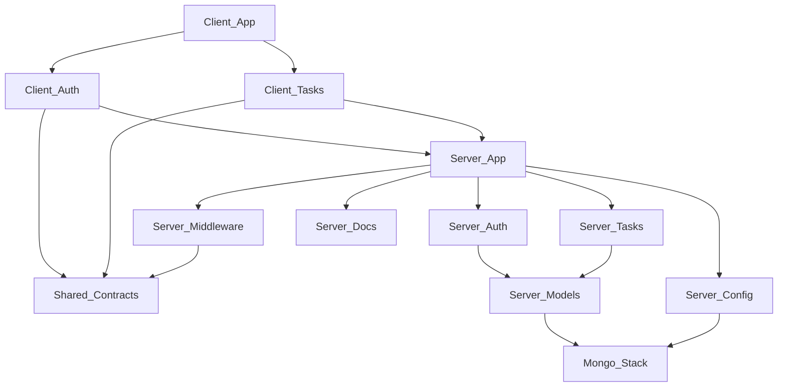

## Stack

- TypeScript 6.0.3 across three npm workspaces; Node >= 22.22.3 (ESM everywhere).
- `server/`: Express 5, Mongoose 9, zod 4, jose (HS256), pino, swagger-ui-express.
- `client/`: Angular 22 — standalone components, signals, zoneless, SCSS tokens.
- `shared/`: zod schemas + inferred DTOs, published to both as `@mean/shared`.
- Data: MongoDB 8.0 in Docker as single-node replica set `rs0` with auth + keyfile.

## Directory map

| path                      | what lives there                                                        |
| ------------------------- | ----------------------------------------------------------------------- |
| `shared/src`              | `@mean/shared`: envelope, pagination, auth and task schemas             |
| `server/src/config`       | zod-validated env, mongoose connection                                  |
| `server/src/lib`          | ApiError, response envelope, cookies, logger                            |
| `server/src/middleware`   | validate, authenticate/authorize, rate limit, errors, 404               |
| `server/src/models`       | User, RefreshToken, Task                                                |
| `server/src/modules`      | auth, tasks, users — service + controller + routes each                 |
| `server/src/routes`       | `/api/v1` router and the health probes                                  |
| `server/src/docs`         | OpenAPI document generated from the shared schemas                      |
| `server/test`             | vitest + supertest against an in-memory replica set                     |
| `client/src/app/core`     | auth store, interceptor, guards, API base                               |
| `client/src/app/features` | auth screens, tasks screens                                             |
| `docker-compose.yml`      | mongo + mongo-init + mongo-express (dev default)                        |
| `docker-compose.full.yml` | adds api + nginx web (everything containerized)                         |
| `deploy/nginx`            | SPA fallback and the `/api` proxy                                       |
| `scripts`                 | toolchain check, doctor, client scaffold, mongo init, full stack, smoke |

## Diagram

## Component index

- [[Client_App]]
- [[Client_Auth]]
- [[Client_Tasks]]
- [[Shared_Contracts]]
- [[Server_App]]
- [[Server_Middleware]]
- [[Server_Auth]]
- [[Server_Tasks]]
- [[Server_Models]]
- [[Server_Config]]
- [[Server_Docs]]
- [[Mongo_Stack]]

## Entry points

- Dev API: `server/src/server.ts` (listens, connects, handles SIGTERM) via `npm run dev -w @mean/server`.
- Dev client: `client/src/main.ts` via `ng serve`, proxy in `client/proxy.conf.json`.
- Test entry: `server/src/app.ts` `createApp()` — no listen, no database connection.
- Prod API: `node server/dist/server.js` (`server/Dockerfile`, context = repo root).
- Prod client: nginx serving `client/dist/client/browser` (`client/Dockerfile`).

## Conventions

- Responses: `{ data, meta? }`; errors `{ error: { code, message, details? } }`.
- Errors are thrown as `ApiError` and rendered only by `middleware/error-handler.ts`.
- Validated input lands on `req.valid`; `req.query` is never assigned to (Express 5).
- Resources are owner-scoped in the query; another user's document is a 404.
- Relative imports carry the `.js` extension (NodeNext ESM).
- Angular: functional guards and interceptors, `inject()`, signals, no NgModules.

## Where things go

- New API resource: see `docs/adding-a-resource.md` (11 files, Task is the worked example).
- New shared type or schema: `shared/src/<area>/*.ts`, then export from `shared/src/index.ts`.
- New middleware: `server/src/middleware/`, mounted in `server/src/app.ts`.
- New env var: `server/src/config/env.ts` schema plus `.env.example`.
- New page: `client/src/app/features/`, then a lazy route in `client/src/app/app.routes.ts`.
