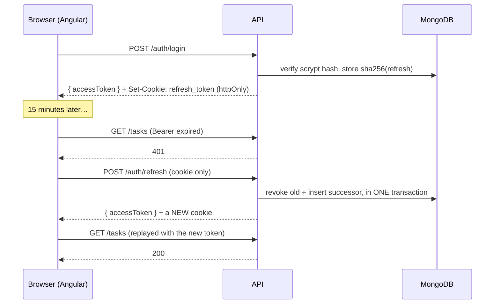

# How sessions work

Two tokens, deliberately different in lifetime, storage and blast radius.

|                    | Access token                               | Refresh token                               |
| ------------------ | ------------------------------------------ | ------------------------------------------- |
| Lifetime           | 15 minutes                                 | 7 days                                      |
| Lives in           | an Angular signal — **memory only**        | an **httpOnly** cookie, `Path=/api/v1/auth` |
| Readable by script | no (never written to storage)              | no (httpOnly)                               |
| Sent with          | `Authorization: Bearer …`                  | automatically, only to `/api/v1/auth/*`     |
| Stored server-side | not at all (it is self-describing, signed) | as a **sha256 hash**, rotated on every use  |

Neither token is in `localStorage`. That is the whole design: an XSS can act as you _while the page is open_, but it cannot walk away with a credential.

## The flow

The replay is invisible to the user and to the calling code: the interceptor handles it.

## Two details that are easy to get wrong

**Single-flight refresh.** If five requests 401 at once and each starts its own refresh, four of them present an already-rotated token — which the server correctly reads as theft. `AuthStore.refresh()` shares one in-flight request (`this.inFlight ??= …`), so concurrent failures queue behind a single rotation and then replay. There is a test for exactly this.

**Reuse detection must revoke outside the transaction.** When a consumed token is presented again, the whole family is revoked. If that revocation happens _inside_ `session.withTransaction()` and the handler then throws, the transaction rolls back and the revocation is undone — reuse detection silently becomes a no-op. `server/test/auth.reuse-detection.spec.ts` asserts that the stolen successor also stops working, which is what fails if this is ever refactored wrongly.

## Why there is no CSRF token

The refresh cookie is `SameSite=Lax`, so a cross-site `POST` does not carry it — and `/auth/refresh` is POST-only. The cookie is also path-scoped, so it is not attached to ordinary API calls at all.

An earlier draft added an Origin-allowlist middleware on top. It was cut: it duplicated the CORS allowlist, rejected every non-browser client (curl, CI, Bruno) because they send no `Origin`, and defended against something `SameSite=Lax` already covers. If you later move to `SameSite=None` for a cross-site front end, you need CSRF protection again — that is the moment to add it back.

## Why the replica set

Rotation revokes the old token and mints its successor. Those two writes must not be separable, so they run in a transaction — and MongoDB transactions require a replica set. That is why `docker-compose.yml` runs `rs0` (with a keyfile, since replication plus auth demands internal cluster auth) and why the test suite uses `MongoMemoryReplSet` rather than a standalone.
